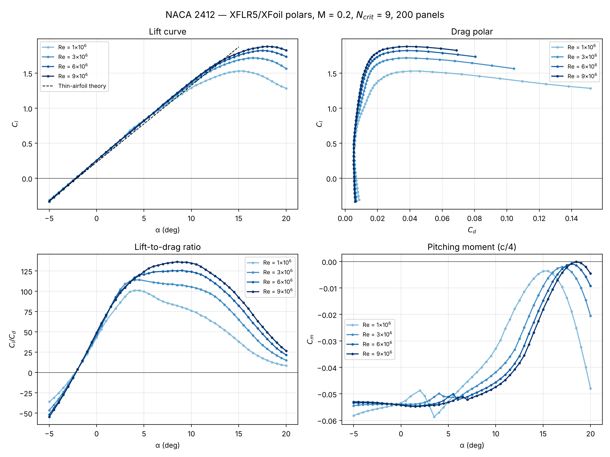
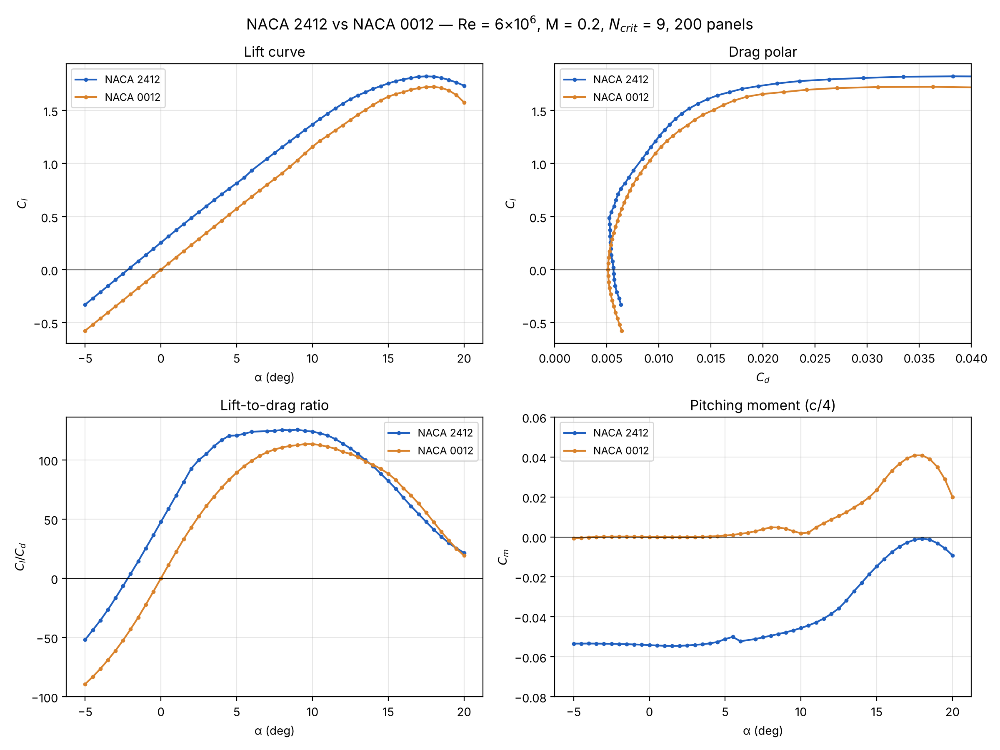
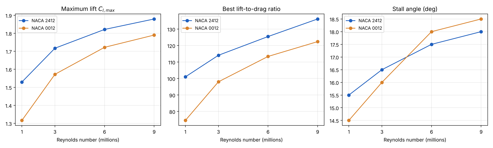
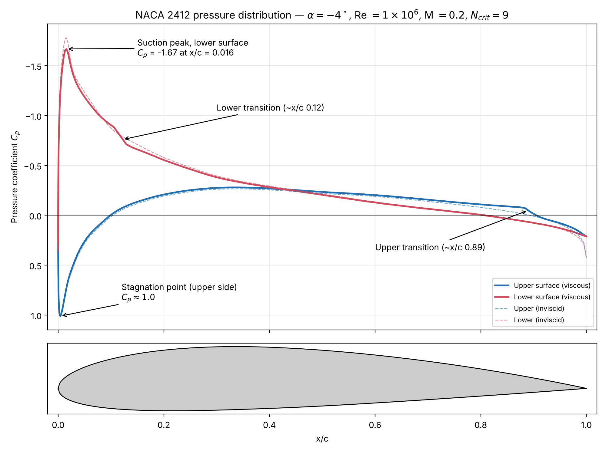

# NACA 2412 Airfoil Aerodynamic Analysis

2D aerodynamic analysis of the NACA 2412 airfoil using **XFLR5 (XFoil)**, with post-processing in **MATLAB** and **Python**. The project simulates lift, drag, pitching moment and surface pressure distribution across four Reynolds numbers, then validates the results against NACA wind-tunnel data and compares the NACA 2412 with the symmetric NACA 0012 to isolate the effect of camber.



## Key results

| Quantity | Re = 1M | Re = 3M | Re = 6M | Re = 9M |
| --- | --- | --- | --- | --- |
| Lift slope (per degree) | 0.114 | 0.114 | 0.114 | 0.115 |
| Zero-lift angle (deg) | −2.2 | −2.2 | −2.2 | −2.2 |
| Cl,max | 1.53 | 1.72 | 1.82 | 1.88 |
| Stall angle (deg) | 15.5 | 16.5 | 17.5 | 18.0 |
| Minimum Cd | 0.0056 | 0.0052 | 0.0052 | 0.0052 |
| Best Cl/Cd | 101 at 4.5° | 114 at 4.5° | 126 at 9.0° | 136 at 8.5° |

**Findings**

- Lift slope and zero-lift angle are almost independent of Reynolds number, and follow thin-airfoil theory closely.
- Higher Reynolds number delays separation: Cl,max rises from 1.53 to 1.88 and stall moves from 15.5° to 18°.
- Efficiency improves strongly with Reynolds number: best Cl/Cd rises from 101 to 136.
- Integrating the exported Cp distribution reproduces XFLR5's lift coefficient to within 1% (−0.196 vs −0.197 at α = −4°).
- Against NACA wind-tunnel data, XFLR5 matches the zero-lift angle and moment well but overpredicts Cl,max by about 7% and underpredicts minimum drag by about 13%.

## Comparison with the NACA 0012

The NACA 0012 has the same 12% thickness and no camber, so every difference comes from camber alone. Both airfoils were run with identical settings.



| Re = 6 million | NACA 2412 | NACA 0012 | Effect of camber |
| --- | --- | --- | --- |
| Zero-lift angle (deg) | −2.2 | 0.0 | curve shifted left |
| Lift slope (per degree) | 0.114 | 0.115 | unchanged |
| Cl,max | 1.82 | 1.72 | +0.10 |
| Cd at Cl = 0.6 | 0.0057 | 0.0065 | 13% less drag |
| Best Cl/Cd | 126 | 113 | +11% |
| Cm, c/4 | −0.053 | 0.000 | nose-down moment |



Camber raises lift by about 0.25 at every angle without changing the slope, and moves the minimum-drag region to cruise lift. At Re = 1 million the advantage grows to 28% less drag at Cl = 0.6 and a 35% higher best Cl/Cd. The cost is a constant nose-down moment, which is why wings use cambered sections and tails use symmetric ones.

## Method

| Setting | Value |
| --- | --- |
| Solver | XFLR5 v6.62 (XFoil panel method + viscous boundary layer) |
| Panels | 200 (refined from a 35-point coordinate file) |
| Airfoils | NACA 2412, NACA 0012 |
| Reynolds numbers | 1, 3, 6 and 9 million |
| Mach number | 0.2 |
| Ncrit | 9 (free transition) |
| Angle of attack | −5° to 20°, step 0.5° |



## Repository structure

```
├── data/
│   ├── geometry/      airfoil coordinate files (.dat)
│   ├── polars/        Cl, Cd, Cm vs angle of attack for each Reynolds number (CSV)
│   └── cp/            pressure distributions exported from XFLR5
├── xflr5/             XFLR5 project files (.xfl) with all polars
├── matlab/
│   ├── naca2412_analysis.m   plots polars and prints key values
│   ├── plot_cp.m             plots a Cp distribution and integrates it
│   └── compare_airfoils.m    overlays NACA 2412 and NACA 0012
├── python/
│   ├── extract_polars.py     reads polars straight from the .xfl file into CSV
│   ├── plot_polars.py        polar plots + key values
│   ├── plot_cp.py            Cp plot + lift check by integration
│   └── compare_airfoils.py   comparison plots + key-value table
├── figures/           generated plots
└── docs/              project report (PDF)
```

## Reproducing the results

**MATLAB** (or the free GNU Octave): open `matlab/naca2412_analysis.m` or `matlab/compare_airfoils.m` and press Run.

**Python** (3.9+):

```bash
pip install -r requirements.txt
cd python
python extract_polars.py ../xflr5/NACA_2412.xfl ../data/polars
python plot_polars.py ../data/polars ../figures/polars_all_Re.png
python plot_cp.py ../data/cp/cp_Re1M_alpha-4.txt ../figures/cp_Re1M_alpha-4.png
python extract_polars.py ../xflr5/NACA_0012.xfl ../data/polars
python compare_airfoils.py ../data/polars naca2412 naca0012 6 ../figures
```

**XFLR5:** open `xflr5/NACA_2412.xfl` to inspect or re-run the analyses.

## Limitations

XFoil is a 2D method, so 3D wing effects are not included. Results near and beyond stall are less reliable because large separated regions are modelled only approximately, and the surface is assumed perfectly smooth.

## References

1. Abbott, I. H. and von Doenhoff, A. E. (1949). *Theory of Wing Sections*. McGraw-Hill.
2. Drela, M. (1989). XFOIL: An analysis and design system for low Reynolds number airfoils.
3. Deperrois, A. *XFLR5 v6 Guidelines*.

## Report

The full write-up, including theory and validation, is in [`docs/NACA2412_report.pdf`](docs/NACA2412_report.pdf).
